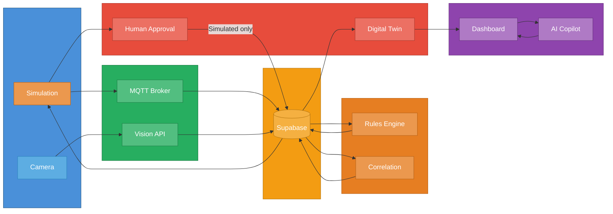

# Campus Impact Twin — Simple Architecture

---

## User Flow

```mermaid
flowchart LR
    A[Dashboard] -->|Live status| B[3D Twin]
    B -->|Click zone| C[Incidents]
    C -->|Ask why| D[Copilot]
    D -->|Suggests action| E[Approvals]
    E -->|You decide| F[Simulated Result]
    F -->|Nothing physical changes| G[Back to Dashboard]

    style A fill:#AF7AC5,stroke:#6C3483,color:#fff
    style B fill:#EC7063,stroke:#B03A2E,color:#fff
    style C fill:#E67E22,stroke:#BA6418,color:#fff
    style D fill:#AF7AC5,stroke:#6C3483,color:#fff
    style E fill:#E74C3C,stroke:#B03A2E,color:#fff
    style F fill:#F39C12,stroke:#B9770E,color:#fff
    style G fill:#27AE60,stroke:#1A7A42,color:#fff
```

---

## One-Liner

> **Sensors → Data → Rules → Incidents → Copilot → You decide → Simulated result**
>
> Nothing acts without a human. Execution is always simulated.
