# Campus Impact Twin — Technical Workflow Diagrams

## 1. System Architecture Overview

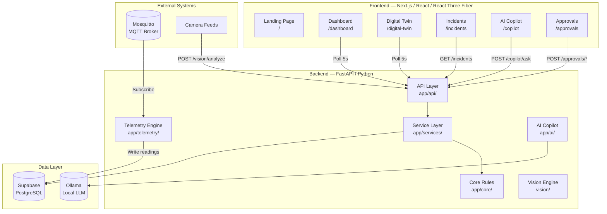

---

## 2. Telemetry Ingestion Pipeline

```mermaid
flowchart LR
    subgraph Sim["Simulator"]
        PHYS[Zone Physics<br/>Deterministic Model]
        TICK[Build Tick<br/>5 sensors]
        PUB[Publish to MQTT]
        PHYS --> TICK --> PUB
    end

    subgraph Broker["MQTT Broker"]
        TOPIC[Topic: smart-campus/campus/{code}<br/>/building/{code}/floor/{code}<br/>/zone/{code}/sensor/{uuid}]
    end

    subgraph Worker["MQTT Worker"]
        VAL[Validate Message<br/>7-step validation]
        ENQ[Enqueue to Writer]
        VAL --> ENQ
    end

    subgraph Writer["TelemetryWriter"]
        BUF[Bounded Buffer<br/>max 500 rows]
        FLUSH[Periodic Flush<br/>every 10s]
        CHUNK[Chunk Insert<br/>200 rows/chunk]
        RETRY[Retry with<br/>Exponential Backoff]
        BUF --> FLUSH --> CHUNK --> RETRY
    end

    subgraph Intelligence["Intelligence Engine"]
        EVAL[Evaluate Rules<br/>5 deterministic rules]
        DEDUP[Deduplicate<br/>zone+category+rule]
        PERSIST[Persist Incident]
        EVAL --> DEDUP --> PERSIST
    end

    subgraph DB[(Supabase)]
        TELEMETRY[(telemetry_readings)]
        INCIDENTS[(incidents)]
    end

    PUB --> TOPIC --> VAL
    ENQ --> BUF
    CHUNK -->|Insert rows| TELEMETRY
    TELEMETRY -->|on_persisted callback| EVAL
    PERSIST --> INCIDENTS
```

---

## 3. Intelligence Engine — Rule Evaluation

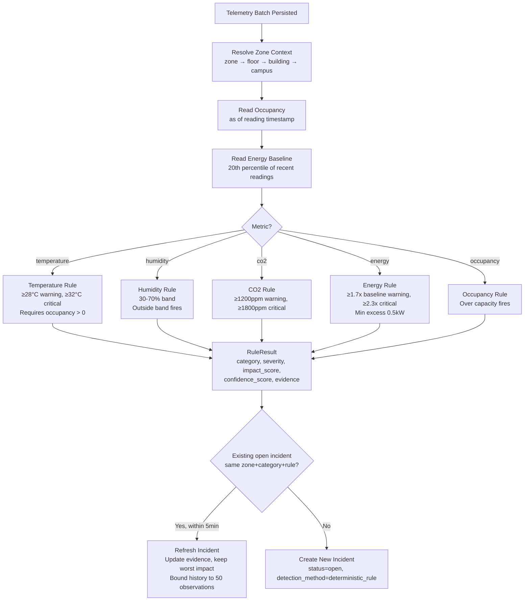

---

## 4. Correlation Engine — Evidence Gate

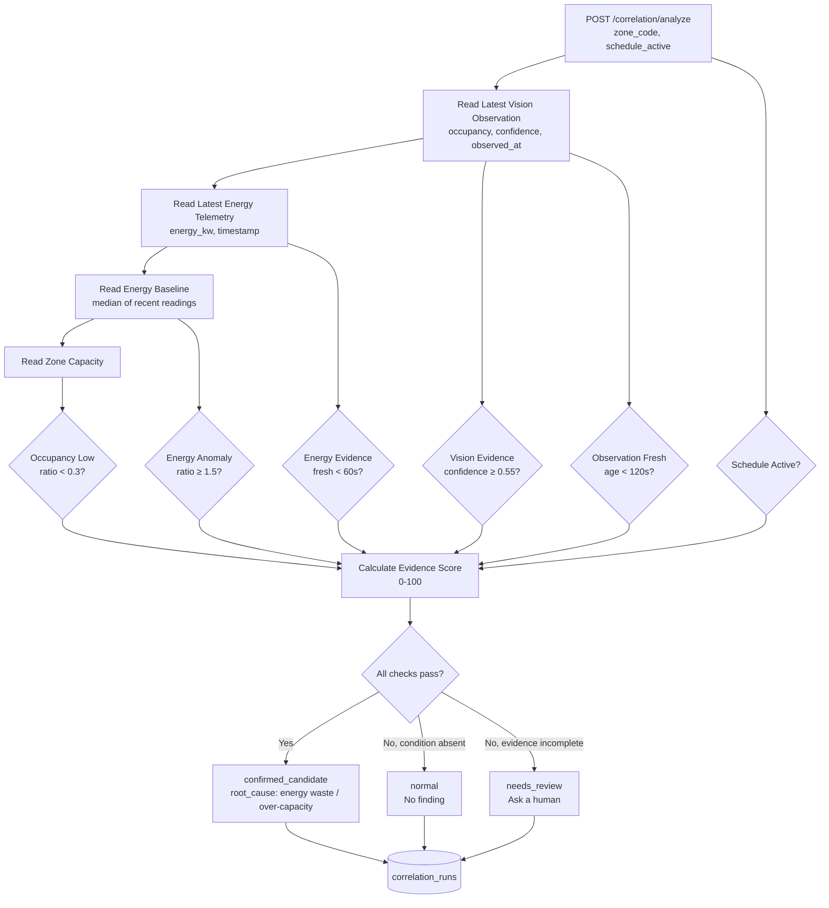

---

## 5. Simulation & Impact Pipeline

```mermaid
flowchart TD
    REQ[POST /simulation/run<br/>zone_code, scenario, interventions, constraints] --> CORR[Load Latest Correlation Run]
    CORR --> CHECK{confirmed_candidate?}
    CHECK -->|No| BLOCKED[status: blocked<br/>No evidenced condition]
    CHECK -->|Yes| CTX[Load Correlation Context<br/>energy, observation, findings]

    CTX --> LIB[Load Intervention Library<br/>Filter by codes/names]
    LIB --> EVAL[For Each Intervention]

    EVAL --> EVID{Evidence Quality<br/>Sufficient?}
    EVID -->|No| INFEASIBLE[Mark Infeasible<br/>evidence too weak]
    EVID -->|Yes| FEAS{Feasibility Check}

    FEAS -->|Budget exceeded| INFEASIBLE
    FEAS -->|Disruption too high| INFEASIBLE
    FEAS -->|Duration too long| INFEASIBLE
    FEAS -->|OK| PROJ[Project Impact]

    PROJ --> IMPACT[Impact Score<br/>energy 35%, water 20%, waste 15%,<br/>co2 15%, business priority 15%]
    IMPACT --> CONF[Confidence Score<br/>vision 25%, telemetry 25%,<br/>baseline 25%, intervention 25%]
    CONF --> COST[Cost Efficiency Score<br/>impact × (1 - normalized_cost)]
    COST --> OVERALL[Overall Score<br/>impact 35%, confidence 25%, feasibility 20%,<br/>cost 10%, disruption 10%]

    OVERALL --> RANK[Rank Options<br/>Infeasible always last<br/>Tie-break: confidence → cost →<br/>disruption → impact → code]
    RANK --> REC[Build Recommendation<br/>Best feasible option<br/>State the trade-off]
    REC --> ARCHIVE[(simulation_runs<br/>simulation_options)]
```

---

## 6. Approval State Machine

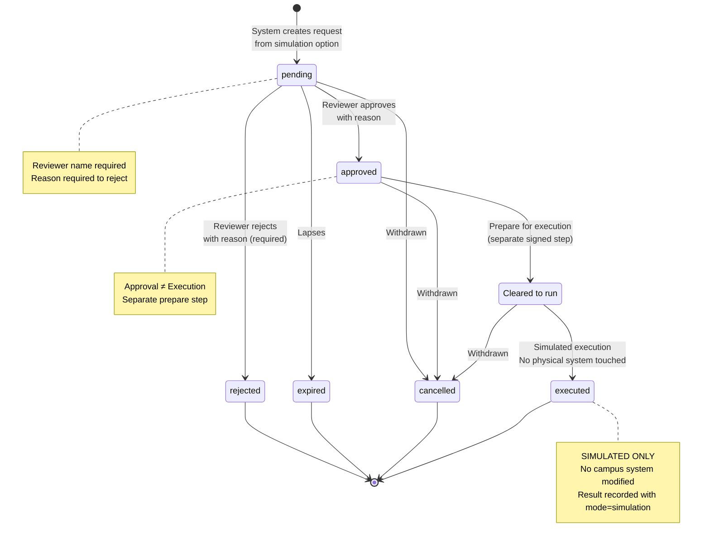

---

## 7. Digital Twin Snapshot Assembly

```mermaid
flowchart TD
    REQ[GET /digital-twin/snapshot] --> ZONES[Load All Zones<br/>with twin_model_object, metadata]
    ZONES --> TELE[Load Latest Telemetry<br/>per zone per metric]
    TELE --> INC[Load Open Incidents<br/>status: open/acknowledged/investigating]
    INC --> CORR[Load Latest Correlation Run<br/>result_status, root_cause]
    CORR --> APPR[Load Pending Approval Count<br/>via simulation_runs join]

    TELE --> METRICS[Map Metrics<br/>temperature, humidity, co2,<br/>occupancy, energy, capacity]
    METRICS --> RATIO[Calculate Occupancy Ratio<br/>occupancy / capacity]
    RATIO --> FRESH{Fresh?<br/>age < threshold}
    FRESH -->|No| OFFLINE[status: offline]
    FRESH -->|Yes| STATUS[Determine Status<br/>from thresholds]

    INC --> RECONCILE[Reconcile with Incidents<br/>incident severity can upgrade status]
    STATUS --> REASONS[Build Status Reasons<br/>human-readable explanations]
    RECONCILE --> REASONS

    REASUES --> ISSUES[Collect Active Issues<br/>incident titles + root_cause]
    REASONS --> ENTITY[TwinEntity<br/>id, code, name, status, metrics,<br/>reasons, issues, position, scale]
    ISSUES --> ENTITY

    ENTITY --> SNAPSHOT[TwinSnapshot<br/>entities[], counts{normal, warning,<br/>critical, offline}]
```

---

## 8. AI Copilot Flow

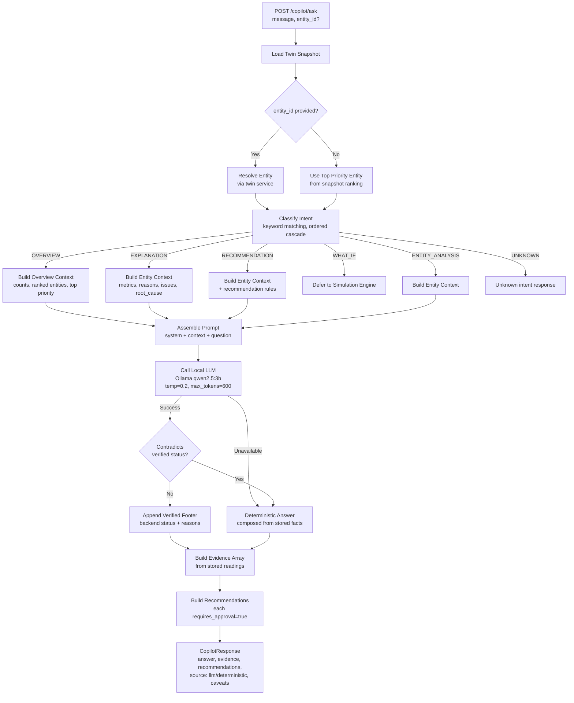

---

## 9. Vision Analysis Pipeline

```mermaid
flowchart TD
    REQ[POST /vision/analyze<br/>image, camera_id, zone_code, observed_at?] --> ZONE{Zone exists?}
    ZONE -->|No| 404[404 Not Found]
    ZONE -->|Yes| VALIDATE{Validate Image}

    VALIDATE -->|Too large >10MB| 413[413 Content Too Large]
    VALIDATE -->|Unsupported format| 415[415 Unsupported Media Type]
    VALIDATE -->|Corrupt/truncated| 400[400 Bad Request]
    VALIDATE -->|Valid JPEG/PNG| DETECT[Run YOLO11n Inference<br/>conf ≥ 0.45, IoU ≥ 0.50, class=person]

    DETECT -->|Model missing| 503[503 Service Unavailable]
    DETECT -->|Inference error| 500[500 Server Error]
    DETECT -->|Success| COUNT[DetectionResult<br/>people_count, confidence, detections[]]

    COUNT --> DEDUP{observed_at provided?}
    DEDUP -->|Yes, existing row| REUSE[Reuse Stored Row<br/>idempotent]
    DEDUP -->|No| INSERT[(vision_observations)]

    REUSE --> MIRROR[(observations)]
    INSERT --> MIRROR

    MIRROR --> RESP[VisionAnalysisResponse<br/>people_count, confidence, detections]
```

---

## 10. Frontend User Journeys

### 10.1 Dashboard Overview Journey

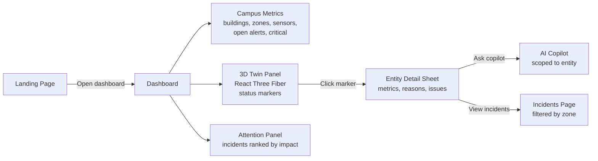

### 10.2 Incident Resolution Journey

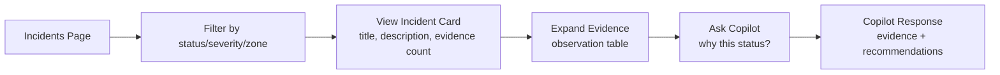

### 10.3 Approval Workflow Journey

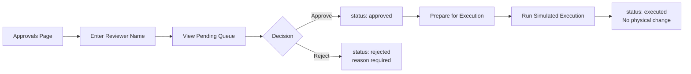

### 10.4 Digital Twin Exploration

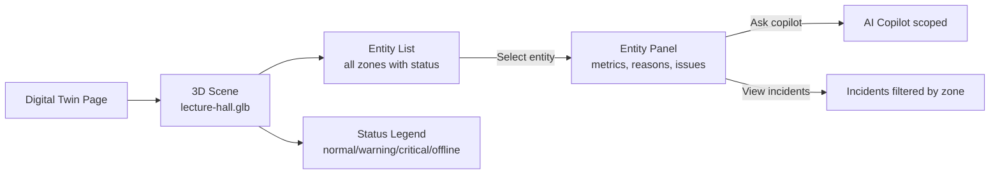

---

## 11. Data Model Relationships

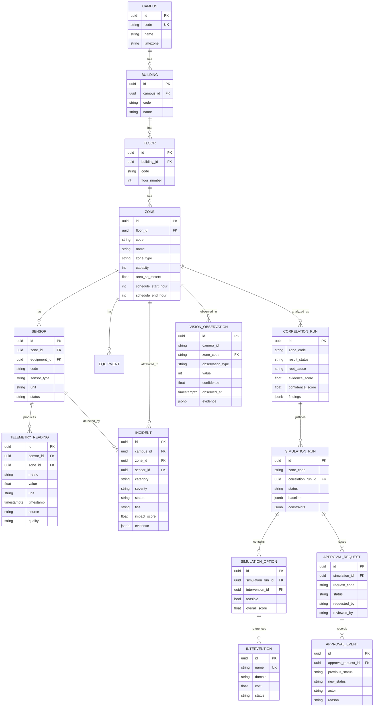

---

## 12. API Endpoint Map

```mermaid
mindmap
  root((API))
    Campus
      GET /campus/{code}/twin
      GET /campus/{code}/telemetry/latest
    Incidents
      GET /incidents
      GET /incidents/summary
    Correlation
      POST /correlation/analyze
      GET /correlation/zone/{code}
    Vision
      POST /vision/analyze
      GET /vision/zone/{code}/latest
      GET /vision/status
    Interventions
      GET /interventions
      GET /interventions/{code}
    Impact
      POST /impact/analyze
    Simulation
      POST /simulation/run
      GET /simulation/{run_id}
      GET /simulation/{run_id}/comparison
    Digital Twin
      GET /digital-twin/snapshot
      GET /digital-twin/entities/{id}
    Approvals
      POST /approvals
      GET /approvals
      GET /approvals/pending
      GET /approvals/{id}
      GET /approvals/{id}/events
      POST /approvals/{id}/review
      POST /approvals/{id}/prepare
      POST /approvals/{id}/execute
    Copilot
      POST /copilot/ask
      GET /copilot/health
    System
      GET /
      GET /health
```

---

## 13. Feature Flags & Degradation

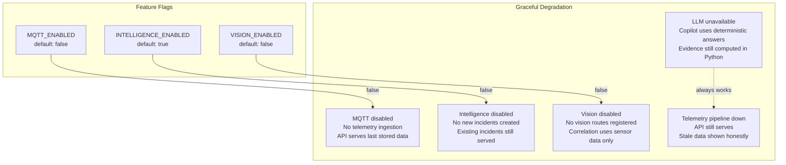

---

## 14. Trust Boundaries

```mermaid
flowchart LR
    subgraph ReadOnly["Read-Only Surfaces"]
        TWIN_API[Digital Twin API<br/>Read-only snapshot]
        INC_API[Incidents API<br/>Read-only listing]
        COP_API[Copilot API<br/>Read-only answers<br/>No write surface]
        SIM_API[Simulation API<br/>Simulated figures only<br/>No actuation]
        INT_API[Interventions API<br/>Read-only library]
        IMP_API[Impact API<br/>Modeled projections]
    end

    subgraph Control["Control Boundary"]
        APPR_API[Approvals API<br/>Only place status changes<br/>Human decision required<br/>Execution is SIMULATED]
    end

    subgraph Ingestion["Ingestion Surfaces"]
        TELE_IN[Telemetry Ingestion<br/>MQTT → Writer → Supabase]
        VISION_IN[Vision Ingestion<br/>Image → Detector → Supabase]
    end

    subgraph External["External Trust"]
        MQTT_BROKER[MQTT Broker<br/>Untrusted messages<br/>7-step validation]
        CAMERA[Camera Image<br/>Untrusted upload<br/>Format + size validation]
        LLM[Llm<br/>Untrusted prose<br/>Contradiction check<br/>Evidence computed in Python]
    end

    External -->|Validated| Ingestion
    Ingestion -->|Stored data| ReadOnly
    ReadOnly -->|Recommendations| Control
    Control -->|Simulated only| Result[No physical<br/>system modified]
```
